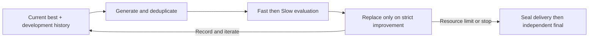

# Simple: a shared iterative optimization baseline

English · [简体中文 and detailed flow](SIMPLE_BASELINE.zh-CN.md)

**Simple is the strong iterative baseline used across DUO research.** It proposes
changes around the current best candidate, uses permitted development feedback,
measures candidates and retains improvements under a frozen selection rule.
It is documented here independently of any one experiment.

## Overview

The checked task-level controllers start by measuring the initial program on
both development partitions. Each generation can propose multiple candidates.
Source duplicates skip execution. Every unique candidate that passes Fast
validity and correctness checks proceeds to Slow; there is no Fast ranking
Top-K filter. A candidate replaces the incumbent only when both stages pass
and the Slow comparator returns `better` under the frozen constraints,
tolerance and sample requirements. Ties, invalid results and worse candidates
retain the incumbent.

The Journal preserves candidates, measurements, decisions and costs. A bounded
projection of permitted development history feeds subsequent generation.
Generation, cost and wall-time limits bound work; unknown costs or execution
errors can stop it sooner. The research process seals the delivered program
and performs independent final evaluation outside search. Development scores
alone do not establish `improvementProven`.

## What the comparison isolates

| Capability | Simple | DUO mechanisms being examined |
|---|---|---|
| Iteration and feedback | Present, including persistent history and deduplication | Additional search and memory mechanisms beyond this baseline |
| Development evaluation | Fast and Slow partitions, with correctness checks | Value of additional evidence under each experiment's protocol |
| Selection | Strict Slow improvement | Fast Top-K gates and bounded-tie exploration in relevant arms |
| Final confirmation | Outside search; no feedback into generation | Same independence requirements apply |

Simple is not a memoryless or single-shot baseline. Having a partition named
Slow does not by itself establish higher-fidelity or independent evidence.

## Versions, evidence and availability

Task, model, data splits, generations, budgets, history projection and quotas
are frozen separately for each experiment. `simple`, `S-current` and `S-aligned`
are study-specific implementations or conditions; their samples and costs
cannot be pooled just because they share a baseline name. See the
[task-study configurations](duo-task-optimization-20261105/SIMPLE_BASELINE.zh-CN.md)
and [experiment index](EXPERIMENTS.md). Earlier `B1 reasonable single-loop`
comparisons have separate adapters and protocols.

The [provenance manifest](SIMPLE_BASELINE_PROVENANCE.json) identifies the two
retained task-level controllers and their history feedback source. The detailed
[Chinese method and flow](SIMPLE_BASELINE.zh-CN.md) records the checked behavior.
Those frozen source snapshots remain local; hashes are not download links.
This method description is not a complete standalone reproduction package,
a new experiment, or a new performance claim.
