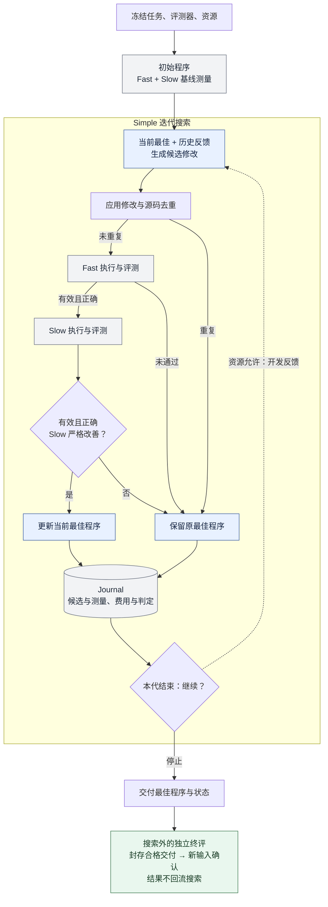

# Simple：跨实验复用的迭代优化基线

**Simple 是 DUO 系列研究中反复使用的强迭代优化基线。** 它围绕当前最佳候选，利用历史反馈生成修改、执行评测，并按既定规则择优保留。我们用它衡量 DUO 额外搜索、记忆和选择机制带来的增量。

这是研究层的公共方法说明，适用于理解不同实验中的 Simple 对照。具体任务、模型、输入划分、代数、预算、历史表示和探索配额，由各实验单独冻结；`S-current`、`S-aligned` 等是具体版本和处理条件。

## 结构图

下图对应已核对的任务级实现：围绕一个当前最佳程序做迭代，Fast 与 Slow 是依次执行的两个开发评测分区。Journal 保存过程记录，并向后续生成提供允许使用的开发反馈。

每代可能产生多个候选，去重与评测路径对每个候选依次执行；Journal 在过程中持续记账，图中将其汇总到本代末尾。重复、无效或非改善候选保留已有最佳程序。资源检查贯穿生成与评测：代数、预算或时间上限触发停止，费用未知、超支或执行异常也可提前终止。虚线表示带着开发反馈进入下一代；独立终评由研究流程安排，Simple 搜索控制器本身不据开发分数宣告 `improvementProven`。

## 已核对的任务级实现

下面的流程依据保留的两版 Simple 控制器及历史反馈实现核对，描述已经用于任务级代码优化的实现。它有持久化 Journal、源码去重、正确性检查、Fast/Slow 两个开发分区和预算控制。不同实验引用时仍需绑定自己的代码版本和配置。

1. **建立起点。** 读取同题初始程序，作为当前最佳程序，在 Fast 和 Slow 两个开发分区上建立测量记录。
2. **带着反馈生成。** 每代把当前最佳程序、任务要求、候选配额和已有候选的开发反馈交给生成器。历史记录包括候选关系、修改假设、测量结果和判定；实际传给模型的是受上下文容量限制的投影。
3. **执行与去重。** 将候选修改应用于当前最佳程序，按源码版本去重。已见源码跳过重复执行和测量，并保留跳过记录。
4. **依次评测。** 对新候选先做 Fast，再做 Slow。评测失败或正确性不通过就停止该候选的后续评测。Simple 没有先按 Fast 排名只取 Top-K 的筛选步骤；每个通过前一阶段检查的未重复候选继续进入第二分区。
5. **保守替换。** 候选在两阶段均通过检查，且 Slow 比较器依照冻结的约束、容差和样本要求判为 `better`，才替换当前最佳程序。等效、更差或不可比较的结果不触发替换。
6. **循环与交付。** 更新 Journal 和历史，直到代数、预算、时间或其他停止条件触发，交付当前最佳程序。未知费用和超支状态也会阻止继续搜索。

搜索结束后，研究流程另外封存程序并做新输入上的终评。终评结果不反馈给上述生成循环；Simple 控制器本身不因为开发测量而宣告 `improvementProven`。

## 它保留了什么，与 DUO 差在哪里

| 能力 | Simple 的做法 | 比较时的含义 |
| --- | --- | --- |
| 多轮优化 | 从当前最佳程序继续生成候选 | 有实际迭代和测量反馈 |
| 历史与记录 | 历史反馈、持久化 Journal、版本与候选去重 | 不能把 DUO 的差异概括成“有记忆对无记忆” |
| 开发评测 | 正确性检查，以及 Fast、Slow 两个开发分区 | Simple 已有第二分区；其名称不证明独立 Slow 信息的价值 |
| 选择规则 | Slow 严格改善才替换当前最佳程序 | 不采用 DUO 的 bounded-tie 探索准入 |
| Fast 筛选 | 逐候选检查后进入 Slow | 不采用 DUO 的 Fast 排名 Top-K gate |
| 额外记忆工具 | 不启用 full 臂的额外记忆工具机制 | 与已有的历史反馈、Journal 分开讨论 |
| 终评 | 搜索外统一封存并确认 | 终评不是优化器可反复查询的反馈接口 |

## 公共方法与实验配置

| 公共方法说明 | 每项实验需要单独记录 |
| --- | --- |
| 从当前最佳候选迭代，利用开发反馈继续生成 | 目标对象、初始候选、生成模型及请求设置 |
| 保存候选历史、Journal 和去重记录 | 历史投影、上下文上限、是否允许跨运行继承 |
| 依据实际评测和明确规则更新当前最佳候选 | 评测器、数据分区、容差、样本要求、替换规则版本 |
| 受资源限制停止并交付 | 代数、请求数、费用与时间上限，以及实际消耗 |
| 将研究终评与搜索反馈分开 | 封存顺序、终评输入、已消费数据和失败处理 |

两组配置同名 Simple，也需要核对版本；共有一个基线方法不代表实验协议、资源或样本可以合并。较早报告中的 `B1 reasonable single-loop` 使用自己的目标适配器和评测协议，见[历史实验记录](EXPERIMENTS.md)，不能直接视为上述任务级控制器的同一版本。

[组件消融与机制对齐中的 Simple 配置](duo-task-optimization-20261105/SIMPLE_BASELINE.zh-CN.md)记录了这些研究的 `simple`、`S-current`、`S-aligned`、模式分配和预算。该实验目录负责记录这些实例；公共方法定义保存在本页。每项研究的采用决定和性能结论也由其自身证据支持。

## 来源与公开范围

[SIMPLE_BASELINE_PROVENANCE.json](SIMPLE_BASELINE_PROVENANCE.json)独立记录本页核对的控制器和历史反馈文件身份、SHA-256 与适用范围。冻结源码快照仍保留本地，哈希不提供下载访问；本说明没有声称提供完整的独立复现实验包，也没有新增模型搜索或性能测量。
